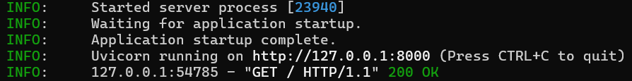
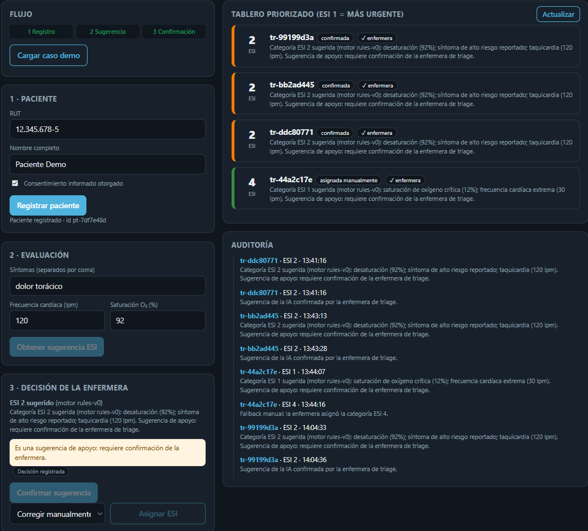
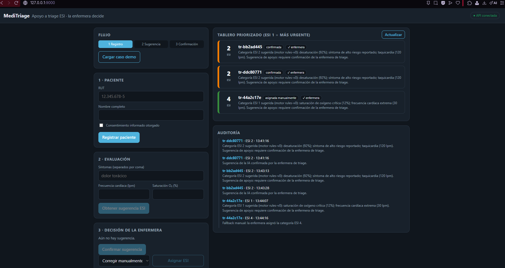
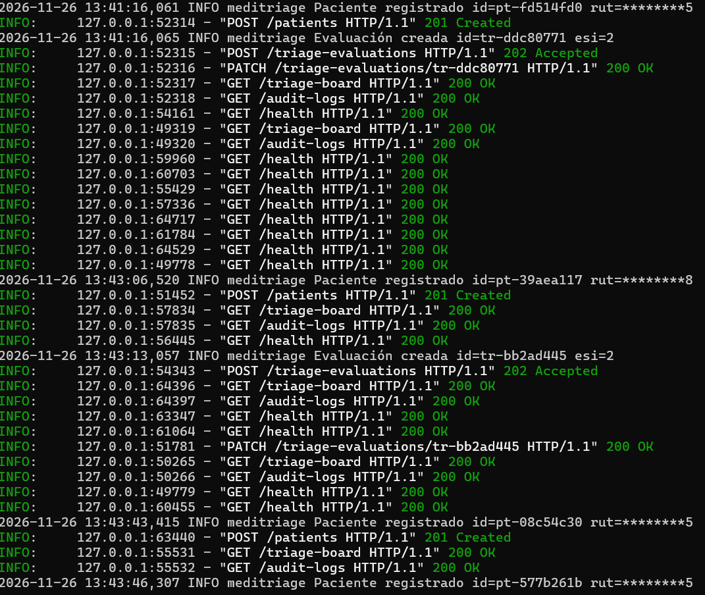

# Mapa de entrega S18 — rúbrica → evidencia en el repositorio

> Cada afirmación apunta a un archivo del repositorio. Lo que no está respaldado se declara como
> pendiente o como limitación. No se incluyen cifras que no hayan sido medidas.
>
> Contexto: el profesor informó que no habrá defensa en vivo y que el trabajo final se entrega en el aula.
> Este archivo y el `README.md` reemplazan a la presentación.

## 1. Cómo reproducir la demo

**Local (Windows PowerShell):**

```powershell
# Terminal 1
$env:AUTH_ENABLED = "false"
uvicorn main:app --port 8000

# Terminal 2
python demo/demo.py
```

**Contra Kubernetes (si hay clúster):** abrir el túnel
`kubectl port-forward -n meditriage deploy/meditriage-api 8080:8000` y ejecutar
`$env:BASE_URL = "http://127.0.0.1:8080"; python demo/demo.py`.

**Interfaz de demo** (no es la SPA diseñada en el C4): `cd demo/ui`, luego
`$env:API_URL = "http://127.0.0.1:8000"; python ui_server.py` y abrir http://127.0.0.1:9000.

### Evidencia capturada (ejecución **local**, API en `127.0.0.1:8000`, sin Kubernetes)

| Captura | Qué muestra |
|---|---|
|  | Servidor `uvicorn` iniciado y respondiendo en el puerto 8000 |
|  | Interfaz con el flujo completo: sugerencia ESI 2 del motor `rules-v0` con su justificación, aviso de que requiere confirmación de la enfermera, decisión registrada, tablero priorizado y auditoría |
|  | Interfaz en el navegador con indicador "API conectada", tablero priorizado (ESI 1 = más urgente) y registro de auditoría |
|  | Log del servidor: el RUT aparece enmascarado (`rut=********5`) al registrar pacientes |

**Notas sobre las capturas:**

- Se tomaron tras varias ejecuciones seguidas. El estado de la API vive en memoria y se acumula, por eso el
  tablero muestra varias evaluaciones y la auditoría tiene más de 2 eventos. Con una ejecución limpia el flujo
  deja 2 eventos por evaluación (sugerencia y confirmación).
- El caso `tr-44a2c17e` es una prueba con datos extremos (saturación 12 %, frecuencia 30). El motor sugirió
  ESI 1 y la enfermera asignó ESI 4 por la vía manual, para ejercitar el fallback manual y comprobar que el
  cambio queda en la auditoría. No representa un caso clínico real.
- Son capturas de una ejecución local. No se presentan como evidencia de Kubernetes.

## 2. Rúbrica

| Criterio (pts) | Evidencia | Estado / limitación declarada |
|---|---|---|
| Demo end-to-end (15) | `README.md` §1, `demo/demo.py`, `demo/ui/`, capturas `docs/img/demo-*.png`, `k8s/`, `docs/img/kubectl-get-all.png`, `docs/img/hpa-scale-up.png` | La demo se ejecutó en local. El despliegue en Kubernetes está evidenciado con las capturas previas del repositorio. La API guarda el estado en memoria y con varias réplicas no se comparte (`docs/operacion/post-mortem.md`) |
| Arquitectura y ADRs (15) | `docs/adr/0001` a `0008`, `docs/c4/` (L1 y L2 con PNG, L3 en `.puml`), `api/openapi.yaml`, `docs/data/`, `docs/arch/` | L1 y L2 describen el diseño objetivo; L3 describe el estado real. Pendiente: Agregar la sección de alternativas en el ADR 0003 |
| DevSecOps (12) | `.github/workflows/ci.yml` (build, Cosign, SLSA), `scans.yml` (Checkov, Trivy, ZAP), `security.yml` (Semgrep, SBOM), `k8s/policies/require-signature.yaml`, `falco/rules-custom.yaml`, `docs/img/s10-*.png`, `docs/adr/0006-supply-chain.md` | SLSA nivel 2 con salvedad. Hay 2 excepciones temporales de Kyverno con fecha límite 2026-12-09 |
| IA responsable (12) | `docs/ia/` (golden set, `evaluate.py`, informe de evaluación, model card), `docs/adr/0007-ia-responsable.md`, `docs/threat-model.md` | Motor determinista `rules-v0`, sin LLM. Sin validación clínica ni análisis de fairness |
| Resiliencia y DR (10) | `docs/operacion/` (SLOs, runbook, post-mortem, game day), `k8s/hpa.yaml`, `k8s/deployment.yaml` | El game day fue un ejercicio de mesa: no se ejecutó en clúster y no hay mediciones. Los SLOs son objetivos sin instrumentar. Los datos se pierden al reiniciar (estado en memoria) |
| FinOps (8) | `docs/finops/costo.md`, `docs/adr/0008-resiliencia-finops.md` | El costo es una estimación, no una factura. Pendiente: medir en CI la palanca de caché de capas (run sin caché frente a run con caché) |
| Calidad y tests (8) | `tests/test_api.py`, `tests/test_unit.py`, `tests/test_contract.py`, `pytest.ini`, `ruff.toml`, `.spectral.yaml`, `docs/api/spectral-report.txt` | Cifras de tests y cobertura: pendientes del primer run de CI con los tests de contrato. El reporte de Spectral conserva 5 warnings de `operation-tags` salvo que se aplique `tools/add_openapi_tags.py` y se verifique |
| Q&A (10) | `docs/seguridad/preguntas-panel.md` | — |
| Trabajo en equipo (5) | `CHARTER.md`, `docs/backlog.md`, historial de commits y pull requests | — |
| Presentación y tiempo (5) | Sin defensa en vivo; este archivo y el `README.md` cumplen esa función | — |

## 3. Alcance real

**Implementado:** API FastAPI, motor `rules-v0`, idempotencia, auditoría en memoria, contenedor distroless,
manifiestos de Kubernetes, HPA, SAST, SCA, DAST e IaC en CI, firma con Cosign, política Kyverno en `Enforce`
y reglas de Falco.

**Solo diseño (no implementado):** SPA web, PostgreSQL, SQS y Lambda, OpenSearch, infraestructura en AWS,
autenticación real (hoy el Bearer es un stub que acepta cualquier token), SLOs medidos.

## 4. Observaciones sobre el contrato OpenAPI

Surgen de comparar `api/openapi.yaml` con `main.py`. Conviene corregirlas o aceptarlas de forma explícita:

- El contrato declara `format: uuid` en los identificadores, pero la API devuelve ids con prefijo
  (`pt-…`, `tr-…`). Los tests de contrato no validan `format` por este motivo.
- `vitalSigns` se responde como `null` si no se envía al registrar, mientras que el contrato lo define como `object`.

## 5. Pendientes declarados

1. Cifras reales de tests y cobertura, tomadas del CI, en `README.md` §7.
2. PNG del C4 nivel 3 (`docs/c4/l3-component.png`) y enlace en `docs/c4/README.md`.
3. Sección "Alternativas consideradas" en los ADR 0001 y 0003.
4. Medición de la palanca de FinOps en CI y registro de los segundos en `docs/finops/costo.md`.
5. Game day en clúster con mediciones reales (hoy solo ejercicio de mesa).
6. Verificación con Spectral tras agregar los `tags` al contrato.
