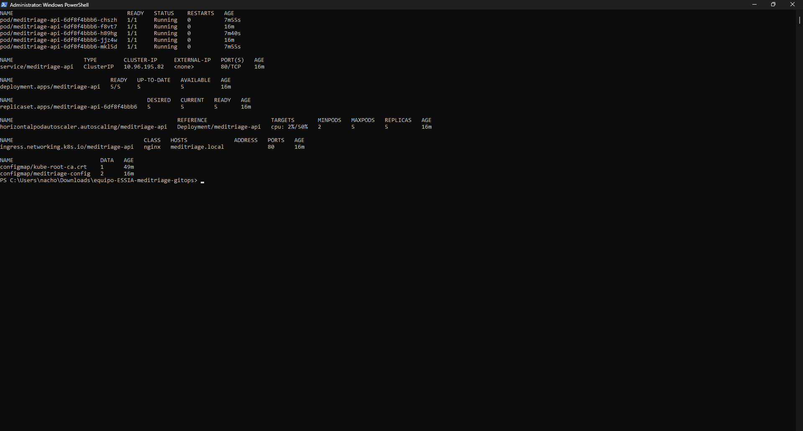
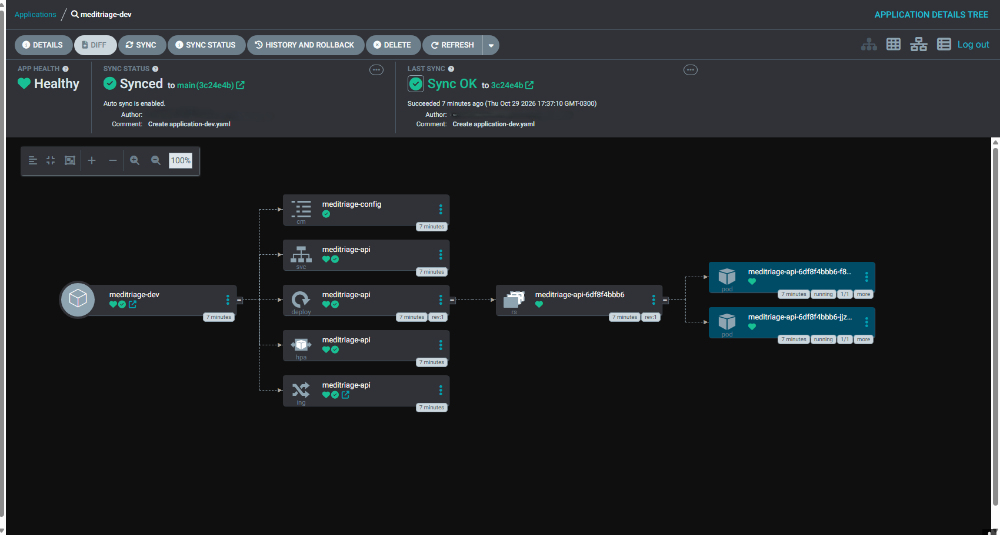
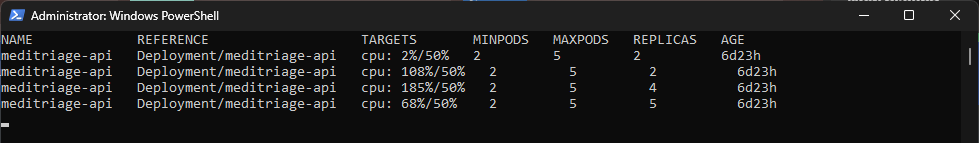
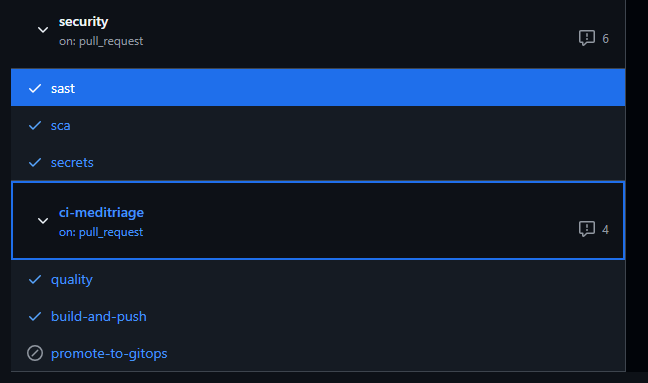

## Descripción

> **MediTriage** es un sistema de apoyo a la priorización clínica en servicios de urgencia. Un motor de IA sugiere la categoría **ESI (1 a 5)** a partir de síntomas y signos vitales, con una justificación legible, y la enfermera de triage siempre confirma o corrige la sugerencia. La IA asiste y no reemplaza al personal de salud.

**Principios del proyecto** (del `CHARTER.md`):
- La IA no es una caja negra: cada sugerencia ESI incluye su justificación.
- Cumplimiento de las leyes chilenas 19.628 y 21.719: consentimiento informado, PII enmascarada en logs y cifrado en tránsito y en reposo.
- Registro de auditoría inmutable, con marca de tiempo, conservado 5 años.
- Objetivos: latencia de inferencia < 3 s (p95) y SLA de 99,5 %.
- Si la IA falla, el personal puede seguir el triage de forma manual.

## Equipo

| Integrante | Rol |
|---|---|
| Martín Garrido | Product Owner |
| Cristóbal Araos | Tech Lead |
| Martín Durán | DevSecOps & Compliance Lead |
| Alonso Plane | QA & Architecture Lead |

## Stack

- **API:** Python 3.11, FastAPI, Uvicorn, Pydantic
- **Contenedor:** Docker multi-stage, imagen final distroless non-root (UID 65532), publicada en GHCR (paquete público)
- **Orquestación:** Kubernetes (Deployment, Service, Ingress, ConfigMap, HPA) con Kustomize. Se ejecuta en Docker Desktop (desarrollo); EKS es el objetivo de producción y aún no está implementado.
- **IaC:** Terraform >= 1.6 (provider de Kubernetes, estado en el backend `kubernetes`). Crea el namespace y un Secret placeholder (`DATABASE_URL`).
- **Contrato de API:** OpenAPI 3.1 (`api/openapi.yaml`)
- **CI/CD:** GitHub Actions (ruff, pytest con cobertura >= 70 %, build y publicación en GHCR)
- **Seguridad (shift-left):** Semgrep (SAST), Trivy sobre SBOM CycloneDX (SCA) y gitleaks (secretos), en un workflow aparte (`security.yml`)
- **GitOps:** Argo CD + Kustomize, con los manifiestos en un repositorio aparte (`equipo-ESSIA-meditriage-gitops`)

**Servicios planificados (aún no implementados):** PostgreSQL en Amazon RDS, SNS + SQS FIFO como broker de eventos y el worker de IA como un Deployment más (ADR 0003 y 0004).

## Estructura del repositorio

```
.
├── .github/workflows/
│   ├── ci.yml              # calidad, build y promoción GitOps (S08)
│   └── security.yml        # SAST, SCA + SBOM y secretos (S09)
├── .semgrep/               # reglas Semgrep propias y sus tests (S09)
├── main.py                 # API FastAPI mínima (S07)
├── Dockerfile              # multi-stage, distroless, non-root
├── requirements.txt
├── requirements-dev.txt    # pytest, pytest-cov, httpx, ruff
├── ruff.toml               # reglas de lint y formato
├── pytest.ini              # cobertura mínima 70 %
├── tests/                  # tests unitarios y de API
├── api/                    # contrato OpenAPI y ejemplos
├── k8s/                    # manifiestos de Kubernetes (+ README con evidencias)
├── terraform/              # namespace, Secret placeholder y backend de estado
├── docs/
│   ├── adr/                # decisiones de arquitectura (0001 a 0005)
│   ├── api/                # política de versionado de la API
│   ├── arch/               # atributos de calidad, servicios gestionados, trazabilidad
│   ├── c4/                 # diagramas C4 (contexto y contenedores)
│   ├── data/               # contextos acotados, DER, catálogo de eventos
│   ├── img/                # capturas de evidencia (S07, S08 y S09)
│   ├── scenarios/          # historias de usuario en Gherkin (US01 a US05)
│   ├── threat-model.md     # modelo de amenazas STRIDE (S09)
│   ├── backlog.md
│   ├── impact-map.md
│   └── 12-factor-checklist.md
└── CHARTER.md              # misión, roles, DoD y política de IA
```

## Endpoints de la API

| Método | Ruta | Para qué |
|---|---|---|
| POST | `/patients` | Registrar paciente (valida RUT y consentimiento) |
| POST | `/triage-evaluations` | Solicitar una evaluación ESI sugerida |
| PATCH | `/triage-evaluations/{id}` | Confirmar o corregir manualmente |
| GET | `/triage-board` | Tablero priorizado (ESI 1 primero) |
| GET | `/audit-logs` | Registro de auditoría |
| GET | `/health` | Probe de Kubernetes (sin auth) |

Las rutas de negocio requieren token Bearer (simulado en esta entrega).

## Cómo correrlo

**Local con Docker**
```bash
docker build -t ghcr.io/guffy0921/meditriage:0.3.1 .
docker run --rm -p 8000:8000 ghcr.io/guffy0921/meditriage:0.3.1
curl http://localhost:8000/health
```
La documentación interactiva queda en `http://localhost:8000/docs`.

**En Kubernetes (clúster local de Docker Desktop)**
```bash
cd terraform && terraform init && terraform apply   # crea el namespace "meditriage" y el Secret placeholder
cd ..
kubectl apply -k k8s/
kubectl get all,ingress,configmap -n meditriage
```
Requiere `metrics-server` para que funcione el HPA.

**Imagen publicada (fijada por digest, nunca `:latest`)**
```
ghcr.io/guffy0921/meditriage@sha256:11a9c511d4ea3351a32c286e1031c35da57a313d298db8dec4091022977e8971
```
El paquete en GHCR es público, así que el clúster puede descargarla sin credenciales.

**Sobre la imagen:** Dockerfile multi-stage (builder `python:3.11-slim`, etapa final `distroless/python3-debian12:nonroot`). Corre como non-root, sin shell ni gestor de paquetes, y solo se copia `main.py`. La justificación de la base image está en el [ADR 0004](docs/adr/0004-datos-y-eventos.md).

## CI/CD y GitOps (S08)

Un cambio en el código llega al clúster sin pasos manuales:

```
Pull Request -> CI (calidad) -> imagen en GHCR por digest -> PR automático en el repo gitops -> merge -> Argo CD despliega
```

**Pipeline (`.github/workflows/ci.yml`)**

| Job | Qué hace |
|---|---|
| `quality` | `ruff check`, `ruff format --check` y `pytest` con cobertura mínima de 70 % |
| `build-and-push` | Construye la imagen; en `push` la publica en GHCR (`ghcr.io/<organización>/meditriage:<sha>`) con `GITHUB_TOKEN` y guarda el digest. En Pull Requests solo construye |
| `promote-to-gitops` | Solo en `push` a `main`: actualiza `overlays/dev` del repo gitops con el digest nuevo (`kustomize edit set image`) y abre un PR. En un Pull Request aparece omitido |

**Repositorio GitOps (`equipo-ESSIA-meditriage-gitops`)**

```
base/            deployment, service, ingress, configmap, hpa + kustomization.yaml
overlays/dev/    namespace meditriage; imagen por digest (la actualiza el CI)
overlays/prod/   namespace meditriage-prod; HPA de 3 a 10 réplicas (solo estructura)
```

- La imagen se referencia siempre por digest, nunca `:latest`.
- El Deployment no declara `replicas`: lo controla el HPA (con `selfHeal`, Argo revertiría un valor fijo).
- **dev:** despliegue automático. **prod:** PR manual con 2 aprobaciones.
- Argo CD (modelo *pull*) sincroniza la aplicación `meditriage-dev` con `main` del repo gitops.

**Calidad en local**
```bash
pip install -r requirements.txt -r requirements-dev.txt
ruff check . && ruff format --check .
pytest
```

Las decisiones y sus alternativas están en el [ADR 0005](docs/adr/0005-gitops-strategy.md).

## Seguridad (S09)

La seguridad se revisa en cada Pull Request, antes de integrar (*shift-left*). El workflow `.github/workflows/security.yml` corre en cada PR y en cada `push` a `main`, y **bloquea el merge** si algún job falla.

**Jobs del workflow**

| Job | Herramienta | Qué revisa | Cuándo falla |
|---|---|---|---|
| `sast` | Semgrep (`p/owasp-top-ten`) | Código fuente | Hallazgos de severidad `ERROR` |
| `sca` | Trivy sobre un SBOM CycloneDX | Dependencias directas y transitivas | Vulnerabilidades HIGH o CRITICAL con corrección disponible |
| `secrets` | gitleaks | Secretos en el árbol y en **todo el historial** de Git | Cualquier secreto detectado |

- **SBOM:** el job `sca` genera `sbom.json` (CycloneDX) y lo publica como artefacto `sbom`. Se descarga desde la página del run, en la sección *Artifacts*.
- **Reglas propias:** viven en `.semgrep/` (por ejemplo, exigir `Depends(require_auth)` en las rutas de negocio). Los endpoints públicos a propósito (`/health` y `/`) quedan excluidos de esa regla. Por ahora se ejecutan en local; incorporarlas al job `sast` es un cambio de una línea en `security.yml`.

### Cómo reproducir los controles en local

```bash
# SAST: reglas del workflow + reglas propias
semgrep scan --config p/owasp-top-ten --config .semgrep/ --severity ERROR --error .
semgrep --test .semgrep/

# SCA: lo mismo que hace la CI, sobre el SBOM (descargado del artefacto "sbom")
trivy sbom --severity HIGH,CRITICAL --ignore-unfixed sbom.json

# SCA, atajo sobre el repositorio (puede diferir un poco del job de CI)
trivy fs --severity HIGH,CRITICAL --ignore-unfixed .

# Secretos, con el historial completo
gitleaks detect --source . --redact
```

### Cómo re-triar un hallazgo

1. **Lee el log del job** que falló y copia el ID exacto (CVE, regla de Semgrep o regla de gitleaks). No lo escribas de memoria.
2. **Clasifica** el hallazgo: verdadero positivo, falso positivo o vulnerabilidad real pero no explotable en MediTriage.
3. **Prioriza** por explotabilidad (¿se alcanza desde un endpoint expuesto?, ¿hay exploit conocido?) y por criticidad del dato que quedaría expuesto (datos clínicos y PII pesan más), no solo por el puntaje CVSS.
4. **Actúa según la clasificación:**
   - *Verdadero positivo:* se corrige (casi siempre subiendo la dependencia o cambiando el código) dentro del plazo de la tabla.
   - *Falso positivo de SAST:* se corrige con un PR que ajuste la regla. **Nunca** se silencia con `# nosec` ni `# nosemgrep` en el código.
   - *No explotable:* se documenta como excepción VEX (ver más abajo).
5. **Deja registro** en la descripción del PR: hallazgo, decisión, responsable y plazo.

### Plazos de remediación

El plazo corre desde la **detección**.

| Severidad | Plazo máximo |
|---|---|
| Critical | < 7 días |
| High | < 30 días |
| Medium | < 90 días |

Si un PR tiene hallazgos High, su descripción debe incluir un plan de remediación o una justificación VEX.

### Cómo pedir una excepción (VEX)

Una excepción se pide en el PR, con esta plantilla:

```
CVE / componente:       CVE-XXXX-XXXXX en <paquete> <versión>
Estado VEX:             not_affected | affected | fixed | under_investigation
Justificación:          por qué no es explotable en MediTriage (o qué se hará para corregirlo)
Evidencia:              enlace al código, test, configuración o log que lo respalda
Responsable:            nombre
Fecha máxima de revisión: AAAA-MM-DD (máximo 90 días desde hoy)
```

Reglas de las excepciones:
- La aprueba **un revisor distinto al autor** del PR.
- **Vencen** en la fecha de revisión (máximo 90 días); pasada la fecha, el hallazgo vuelve a bloquear hasta que se corrija o se renueve con nueva evidencia.
- **Los secretos no admiten excepción.** Si gitleaks detecta uno, se revoca y se rota la credencial de inmediato; borrarla del código no basta, porque queda en el historial.

### Modelo de amenazas

El análisis STRIDE de MediTriage, con el estado real de cada mitigación (implementada o planificada), está en [`docs/threat-model.md`](docs/threat-model.md).

## Enlaces a ADRs

| ADR | Tema |
|---|---|
| [0001](docs/adr/0001-eleccion-iniciativa.md) | Elección de la iniciativa MediTriage |
| [0002](docs/adr/0002-estilo-arquitectonico.md) | Estilo arquitectónico (monolito modular) |
| [0003](docs/adr/0003-cloud-style.md) | Estilo cloud y servicios gestionados (AWS). Su decisión de cómputo fue refinada por el 0004 |
| [0004](docs/adr/0004-datos-y-eventos.md) | Datos, eventos y plataforma de ejecución (PostgreSQL, SNS + SQS FIFO, contenedores, Kubernetes y Terraform) |
| [0005](docs/adr/0005-gitops-strategy.md) | Estrategia de despliegue con GitOps (Argo CD, Kustomize, repo separado) |

## Evidencias

### S07: despliegue en Kubernetes y autoescalado

Recursos desplegados (`kubectl get all,ingress,configmap -n meditriage`):



### S08: GitOps con Argo CD

Aplicación `meditriage-dev` en **Synced** y **Healthy**, sincronizada con `main` del repo gitops:



Prueba del HPA con carga sintética sobre `/health`: la CPU medida pasó de 2 % a 108 %, luego 185 % y bajó a 68 % del objetivo (50 %), y las réplicas pasaron de 2 a 4 y luego a 5, el máximo configurado.



### S09: controles de seguridad en verde

Checks de un Pull Request con `sast`, `sca` y `secrets`, junto a `quality` y `build-and-push`:



### Diagramas

Diagramas C4: [`docs/c4/`](docs/c4/)

## Limitaciones conocidas

- El estado vive en memoria de cada pod. Con varias réplicas, cada una tiene el suyo y se pierde al reiniciar (el factor 6 de 12-Factor figura como "No cumple"). En producción irían RDS PostgreSQL y SNS + SQS FIFO.
- El registro de auditoría también está en memoria, por lo que no cumple todavía el requisito de inmutabilidad y conservación de 5 años.
- La autenticación Bearer es un stub y solo verifica que el header exista.
- No hay *rate limiting* en la API.
- `/` expone la versión y el entorno sin autenticación (divulgación de información, severidad Medium, plazo de 90 días).
- El motor ESI es de reglas simples (`rules-v0`), no criterio clínico validado.
- EKS es el objetivo de producción, pero aún no está implementado.
- Sin shell en la imagen distroless, no se puede usar `kubectl exec`. Se depura con logs.
- El `GITOPS_TOKEN` es un Personal Access Token que vence cada 90 días y hay que rotarlo a mano (ver ADR 0005).
- El entorno `prod` del repo gitops es solo estructura; no hay clúster de producción.
- En el clúster local no hay ingress controller, así que el Ingress nunca recibe dirección IP y quedaría en *Progressing*. Para que Argo CD lo marque como sano, se definió una regla de salud personalizada para el Ingress en `argocd-cm` (`resource.customizations.health`). Además, `metrics-server` corre con `--kubelet-insecure-tls`, solo para desarrollo local.
