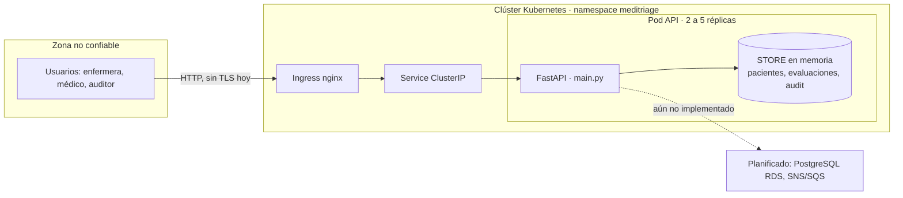

# Modelo de amenazas (STRIDE) · API Backend de MediTriage

- **Autor:** Alonso Plane (QA & Architecture Lead)
- **Fecha:** 05/11/2026 · **Versión:** 1.2 (definitiva S09)
- **Componente analizado:** API Backend (`main.py`, FastAPI) y su despliegue en Kubernetes (`k8s/`, `Dockerfile`)
- **Relacionado:** ADR 0002 (monolito modular), ADR 0004 (datos, eventos y plataforma, con su anexo de seguridad), `docs/12-factor-checklist.md`

> **Cómo leer este documento.** La columna *Estado real* describe lo que el repositorio hace **hoy**, verificado contra el código, los manifiestos, los tests y el SBOM del último run de CI (`sbom.json`, artefacto `sbom`). Cada fila es "Implementada" o "Planificada".

## 1. Alcance y supuestos

**Dentro del alcance:** los endpoints de la API, su autenticación, el manejo de datos clínicos en memoria, el contenedor y el Deployment/Ingress/HPA que lo ejecutan.

**Fuera del alcance (se cubren en otros documentos):** SPA, worker de IA, broker, bases de datos, red del proveedor cloud. Hoy esos componentes no existen o están solo planificados (ver ADR 0004).

**Supuestos sobre el estado actual del MVP:**
- El estado vive **en la memoria de cada pod** (`STORE` en `main.py`); no hay PostgreSQL todavía.
- La autenticación Bearer es un **stub**: acepta cualquier token no vacío.
- El Ingress de `k8s/ingress.yaml` expone `meditriage.local` por HTTP, sin sección `tls`.

## 2. Diagrama de flujo y fronteras de confianza

**Fronteras de confianza:** (1) Internet/usuario → Ingress; (2) Ingress → pod; (3) pod → almacenamiento (hoy memoria, mañana RDS/SQS).

## 3. Superficie de ataque

| Endpoint | Auth | Datos que maneja |
|---|---|---|
| `GET /health` | No (a propósito: probes de K8s) | Ninguno |
| `GET /` | No | Nombre del servicio, versión y `APP_ENV` |
| `GET /docs`, `/redoc`, `/openapi.json` | No (valores por defecto de FastAPI) | Contrato completo de la API |
| `POST /patients` | Bearer (stub) | **RUT, nombre completo**, consentimiento, signos vitales |
| `POST /triage-evaluations` | Bearer (stub) | Síntomas, signos vitales, categoría ESI |
| `PATCH /triage-evaluations/{id}` | Bearer (stub) | Confirmación o categoría ESI manual |
| `GET /triage-board` | Bearer (stub) | Todas las evaluaciones |
| `GET /audit-logs` | Bearer (stub) | Todas las decisiones y sus justificaciones |

**Activos a proteger:** datos personales y de salud (Leyes 19.628 y 21.719), integridad de la categoría ESI (decisión clínica), integridad y disponibilidad del registro de auditoría, disponibilidad del servicio (SLA 99,5 %).

## 4. Análisis STRIDE

**Leyenda de estado:** ✅ Implementada (la mitigación principal ya existe en el repositorio) · 📅 Planificada (la mitigación principal aún no existe). En las filas planificadas, "Ya existe" indica lo que sí hay hoy.
**Riesgo** = impacto × probabilidad en el contexto actual (Alto, Medio, Bajo).

### S · Spoofing (suplantación de identidad)

| ID | Amenaza | Riesgo | Mitigación | Estado real | Evidencia |
|---|---|---|---|---|---|
| S1 | Un atacante usa un token inventado (por ejemplo `Bearer x`) y es aceptado como usuario válido. | Alto | Validar JWT contra el proveedor de identidad: firma, expiración, `aud` y `iss`. | 📅 Planificada. Hoy la validación solo comprueba el formato `Bearer <algo>`. | `main.py` (`require_auth`), docstring del módulo |
| S2 | La autenticación se apaga por error con `AUTH_ENABLED=false` en producción. | Medio | Valor por defecto seguro y fallo de arranque si `APP_ENV=production` y la auth está apagada. | 📅 Planificada (fallo de arranque en producción). Ya existe: valor por defecto `true`; el ConfigMap no lo define. | `main.py` línea de `AUTH_ENABLED`; `k8s/configmap.yaml`; `test_auth_can_be_disabled_by_env` |

### T · Tampering (manipulación)

| ID | Amenaza | Riesgo | Mitigación | Estado real | Evidencia |
|---|---|---|---|---|---|
| T1 | Alguien con cualquier token cambia la categoría ESI de una evaluación, incluso varias veces. | Alto | RBAC (solo rol enfermera), estado terminal tras confirmar y auditoría de cada cambio. | 📅 Planificada (RBAC y estado terminal). Ya existe: rango 1 a 5 validado y cada cambio queda en el audit log. | `TriageUpdateIn`, `update_triage_evaluation` |
| T2 | Se altera o se pierde el registro de auditoría. | Alto | Tabla append-only en PostgreSQL, hash encadenado y réplica WORM en S3 (anexo del ADR 0004). | 📅 Planificada (PostgreSQL append-only, hash y WORM). Ya existe: solo `append` y ningún endpoint modifica entradas. Vive en memoria y se pierde al reiniciar el pod. | `_audit`; `test_audit_log_is_append_only` |
| T3 | Datos de entrada maliciosos o fuera de rango. | Medio | Validación de esquema con Pydantic, RUT con módulo 11 y errores uniformes. | ✅ Implementada. Rangos de signos vitales, `fullName` ≤ 200, `symptoms` ≤ 50 elementos y RUT con módulo 11. Mejora planificada: largo máximo por síntoma y formato de `patientId`. | `VitalSigns`, `PatientIn`, `TriageIn`; tests de validación |
| T4 | Con 2 o más réplicas el estado diverge: un PATCH puede caer en un pod que no tiene la evaluación. | Alto | Persistencia compartida (PostgreSQL). | 📅 Planificada (PostgreSQL). Limitación documentada: factor 6 de 12-Factor incumplido. | `STORE`; ADR 0004; `docs/12-factor-checklist.md` |
| T5 | Dependencias o imagen alteradas en la cadena de suministro. | Alto | Versiones fijadas, imagen por digest, SAST, SCA y escaneo de secretos en CI, y firma de artefactos. | ✅ Implementada. Versiones fijadas, imagen por digest, SBOM CycloneDX y los 3 jobs de `security.yml` (SAST, SCA y secretos) en verde. `fastapi` ya fue subido a 0.162.0 (starlette 1.10.0; ver sección 5). Planificado: fijar las transitivas (`starlette` incluida) y firmar artefactos (S10). | `requirements.txt`, `k8s/deployment.yaml`, `.github/workflows/security.yml`, `sbom.json` |

### R · Repudiation (repudio)

| ID | Amenaza | Riesgo | Mitigación | Estado real | Evidencia |
|---|---|---|---|---|---|
| R1 | Un usuario niega haber confirmado o cambiado una categoría, porque el registro no dice quién fue. | Alto | Guardar `actor_id`, rol, IP y `request_id` en cada entrada del audit log. | 📅 Planificada. Hoy cada entrada guarda solo `evaluationId`, `esiCategory`, `justification` y `timestamp`. | `_audit` |
| R2 | No se pueden correlacionar una petición y sus logs. | Medio | Incluir `trace_id` en los logs y centralizarlos. | 📅 Planificada (`trace_id` en logs y centralización). Ya existe: `trace_id` en cada respuesta de error; no se escribe en los logs. | `problem_response`; `LOG_LEVEL` |
| R3 | No se puede demostrar qué versión del motor tomó una decisión. | Bajo | Justificación con la versión del motor, confirmación humana obligatoria y marca de tiempo UTC. | ✅ Implementada. | `classify_esi` ("motor rules-v0"); `test_audit_log_records_each_decision` |

### I · Information disclosure (filtración de información)

| ID | Amenaza | Riesgo | Mitigación | Estado real | Evidencia |
|---|---|---|---|---|---|
| I1 | RUT y nombre quedan en claro en memoria y en las respuestas. No hay cifrado en reposo. | Alto | Cifrado en reposo con KMS, `rut_hash` con HMAC y minimización de campos. | 📅 Planificada. Depende de la integración con RDS. | `register_patient`; ADR 0004 (anexo) |
| I2 | El RUT aparece en los logs. | Medio | Enmascarar el RUT y no registrar nombre ni síntomas. | ✅ Implementada. Solo se imprime el último carácter del RUT. | `mask_rut`; `test_rut_is_masked_in_logs` |
| I3 | Intercepción del tráfico: el Ingress sirve HTTP sin cifrar. | Alto | TLS en el Ingress (certificado gestionado) y HSTS. | 📅 Planificada. `ingress.yaml` no tiene sección `tls`. | `k8s/ingress.yaml` |
| I4 | Cualquiera lee el contrato completo (`/docs`, `/openapi.json`) y la versión y entorno (`/`). | Medio | Desactivar la documentación interactiva cuando `APP_ENV=production`. | 📅 Planificada. La app se crea con los valores por defecto de FastAPI y `GET /` responde sin autenticación. | `app = FastAPI(...)` |
| I5 | Acceso horizontal: cualquier token lista todas las evaluaciones y todo el audit log, sin límite por rol ni por centro. | Alto | RBAC por rol y por centro de atención. | 📅 Planificada (misma raíz que S1 y E1). | `triage_board`, `audit_logs` |
| I6 | Los errores revelan detalles internos (trazas, rutas). | Medio | Respuestas RFC 7807 sin stack trace y con `trace_id`. | ✅ Implementada. Los errores de validación solo informan campo y motivo. | `_validation_handler`; tests con `_assert_problem` |

### D · Denial of service (denegación de servicio)

| ID | Amenaza | Riesgo | Mitigación | Estado real | Evidencia |
|---|---|---|---|---|---|
| D1 | Ráfaga de peticiones que satura CPU o tumba pods. | Alto | Escalado automático, límites de recursos, probes y rate limiting en el Ingress. | 📅 Planificada (rate limiting en el Ingress). Ya existe: HPA de 2 a 5 réplicas al 50 % de CPU, `requests` y `limits`, probes y `maxUnavailable: 0`. | `k8s/hpa.yaml`, `k8s/deployment.yaml` |
| D2 | Agotamiento de memoria: `STORE` y las claves de idempotencia crecen sin límite y el pod llega al límite de 256 Mi. | Medio | Persistir en BD, expirar claves de idempotencia (TTL) y limitar el tamaño de cada string. | 📅 Planificada. | `STORE`, `_idem_save`; `limits.memory` |
| D3 | Un único `LOCK` serializa las escrituras y degrada la latencia bajo carga. | Bajo | Reemplazar con transacciones de base de datos. | 📅 Planificada (riesgo aceptado en el MVP: mantiene la consistencia mientras el estado está en memoria). | `LOCK` en `main.py` |

### E · Elevation of privilege (elevación de privilegios)

| ID | Amenaza | Riesgo | Mitigación | Estado real | Evidencia |
|---|---|---|---|---|---|
| E1 | Un usuario autenticado ejecuta funciones de otro rol (por ejemplo, un paciente confirma triage o lee la auditoría). | Alto | Roles y permisos por endpoint (paciente, enfermera, médico, auditor). | 📅 Planificada. No existe el concepto de rol. | `require_auth` |
| E2 | Compromiso de la app y escape hacia el nodo. | Alto | Contenedor mínimo, no-root y con capacidades eliminadas. | ✅ Implementada. Distroless sin shell, UID 65532, `readOnlyRootFilesystem`, `allowPrivilegeEscalation: false`, `drop ALL` y `seccompProfile: RuntimeDefault`. | `Dockerfile`, `k8s/deployment.yaml` |
| E3 | El token de la ServiceAccount por defecto está montado en el pod aunque la API no usa la API de Kubernetes. | Medio | `automountServiceAccountToken: false` y una ServiceAccount dedicada. | 📅 Planificada. | `k8s/deployment.yaml` |
| E4 | Movimiento lateral: sin reglas de red, un pod comprometido llega a cualquier otro. | Medio | `NetworkPolicy` con denegación por defecto y excepciones mínimas. | 📅 Planificada. No hay `NetworkPolicy` en `k8s/`. | `k8s/` |

## 5. Hallazgos del SCA y su remediación

**Antes:** `fastapi==0.110.0` fijaba `starlette==0.36.3`. **Ahora:** `fastapi==0.162.0`, `pydantic==2.14.3` y, según el SBOM, `starlette==1.10.0`. El job `sca` (Trivy sobre el SBOM, severidad HIGH y CRITICAL, solo con corrección disponible) termina en verde.

Advisories públicos que afectaban a `starlette 0.36.3` y su estado con la versión actual:

| Advisory | Tipo | Corregido en | Estado con starlette 1.10.0 |
|---|---|---|---|
| CVE-2024-47874 | DoS por `multipart/form-data` | starlette 0.40.0 | ✅ Corregido (1.10.0 ≥ 0.40.0) |
| CVE-2025-54121 | DoS al procesar archivos grandes en formularios multipart | starlette 0.47.2 | ✅ Corregido (1.10.0 ≥ 0.47.2) |
| CVE-2026-48818 (PYSEC-2026-2281) | **SSRF** y robo de credenciales NTLM por rutas UNC en `StaticFiles` | starlette 1.1.0 | ✅ Corregido (1.10.0 ≥ 1.1.0) |
| CVE-2026-54283 | DoS por límites (max_fields, max_part_size) ignorados en application/x-www-form-urlencoded (CVSS 7.5, alta) | starlette 1.3.1 | ✅ Corregido (1.10.0 ≥ 1.3.1) |

**Lectura:** la subida de versión cierra los advisories conocidos. Aun así, ninguno era alcanzable en MediTriage: la API solo recibe JSON, no declara `Form` ni `File`, no usa `StaticFiles` y no llama a `request.form()`.

**Límites del control (qué no cubre el SCA):**
- Con `severity: HIGH,CRITICAL` e `ignore-unfixed`, los hallazgos Medium o sin corrección **no bloquean** el PR. Se gestionan con el plazo de re-triaje del README (Medium < 90 días).
- `uvicorn==0.28.0` no se modificó en esta entrega. Revisar su actualización en el siguiente ciclo.
- No hay excepciones VEX vigentes en este momento.

## 6. Resumen

| Estado | Cantidad | IDs |
|---|---|---|
| ✅ Implementada | 6 | T3, T5, R3, I2, I6, E2 |
| 📅 Planificada | 17 | S1, S2, T1, T2, T4, R1, R2, I1, I3, I4, I5, D1, D2, D3, E1, E3, E4 |

**Lectura:** los controles de **contenedor, validación de entrada, manejo de errores y cadena de suministro** están activos. El mayor riesgo está en **identidad y autorización** (S1, E1, I5, T1, R1): al ser un stub, un solo cambio, JWT real con roles, cierra cinco amenazas de riesgo alto.

## 7. Plan de mitigación priorizado

| Prioridad | Acción | Amenazas que cierra | Cuándo |
|---|---|---|---|
| 1 | Validar JWT y agregar RBAC por endpoint | S1, E1, I5, T1 | Antes de manejar datos reales |
| 2 | Registrar `actor_id`, rol y `request_id` en el audit log | R1, R2 | Junto con la prioridad 1 |
| 3 | TLS en el Ingress | I3 | Antes de exponer fuera del equipo |
| 4 | Persistir en PostgreSQL con cifrado y audit append-only con hash | T2, T4, I1, D2 | Siguiente hito de datos |
| 5 | Deshabilitar `/docs` en producción, no exponer versión ni entorno en `GET /` y agregar rate limiting en el Ingress | I4, D1 | Cambio pequeño |
| 5b | ✅ Hecho: `fastapi` 0.162.0 con `starlette` 1.10.0 (sección 5). Pendiente: fijar `starlette` y las demás transitivas en `requirements.txt` | T5 | Siguiente ciclo |
| 6 | `automountServiceAccountToken: false` y `NetworkPolicy` | E3, E4 | Cambio pequeño de manifiestos |

## 8. Relación con los controles del pipeline (S09)

| Control | Amenazas que reduce | Estado |
|---|---|---|
| SBOM CycloneDX | T5 (visibilidad de dependencias) | ✅ Generado como artefacto `sbom` en `security.yml` y validado (ver 8.1) |
| SCA (Trivy sobre el SBOM) | T5 (dependencias vulnerables) | ✅ Job `sca` en verde con las versiones actuales |
| SAST (Semgrep: `p/owasp-top-ten` y 2 reglas propias con tests) | T3 (patrones inseguros en el código) | ✅ Job `sast` en verde |
| Escaneo de secretos (gitleaks, historial completo) | Credenciales en el repositorio | ✅ Job `secrets` en verde |
| Protección de rama y checks requeridos | T5 (cambios sin revisión ni controles) | ✅ `quality`, `sast`, `sca`, `secrets`) |

### 8.1 Validación del `sbom.json`

| Comprobación | Resultado |
|---|---|
| Formato y versión | CycloneDX 1.6, `serialNumber` UUID válido, generado el 05/11/2026 con `cyclonedx-py 8.0.1` |
| Componentes | 16, todos con `type`, `name`, `version` y `purl` coherentes entre sí |
| Referencias | `bom-ref` únicos y grafo de dependencias sin referencias rotas (16 entradas) |
| Contra `requirements.txt` | `fastapi 0.162.0`, `uvicorn 0.28.0` y `pydantic 2.14.3` coinciden exactamente |
| Transitivas relevantes | `starlette 1.10.0`, `pydantic_core 2.50.4`, `anyio 4.16.0`, `h11 0.16.0`, `click 8.5.0` |
| Dependencias de desarrollo | No hay (`pytest`, `ruff`, `httpx` y similares no aparecen) |
| Licencias | 15 de 16 componentes las declaran (falta `setuptools`) |

**Observaciones para mejorar (siguiente ciclo):**
- Incluye `pip 24.0` y `setuptools 79.0.1`: el SBOM se generó desde el entorno de CI, no desde la imagen. Esos paquetes no están en el contenedor (las dependencias se instalan con `--target=/deps`), así que podrían generar falsos positivos en el SCA. Corrección prevista: crear el venv sin pip.
- Falta el componente raíz (`metadata.component`): el SBOM no identifica a la propia aplicación MediTriage ni su versión.
- Las dependencias transitivas (incluida `starlette`) no están fijadas en `requirements.txt`. El SBOM refleja lo que resolvió el CI, y el build de Docker puede resolver otras versiones.
- No incluye hashes, lo cual es normal en este modo de generación.
- La validación fue estructural. La validación contra el esquema oficial JSON de CycloneDX debe correrse con `cyclonedx-cli validate`.

## 9. Mantenimiento de este documento

- Al cerrar una amenaza, cambiar su estado y enlazar el PR que la resolvió.
- Si cambia la arquitectura (por ejemplo, se agrega PostgreSQL), revisar T2, T4, I1 y D2. Si se actualizan las dependencias, regenerar el SBOM y revisar T5, la sección 5 y la 8.1.
- Revisar el modelo completo antes de cada hito de entrega.
